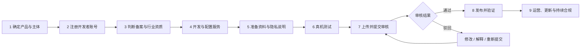
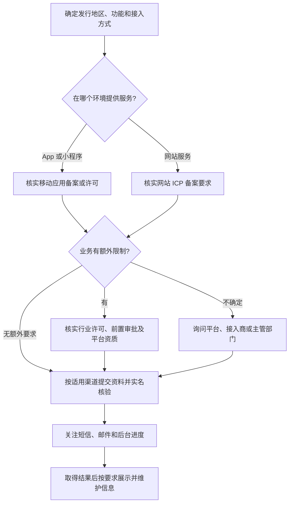
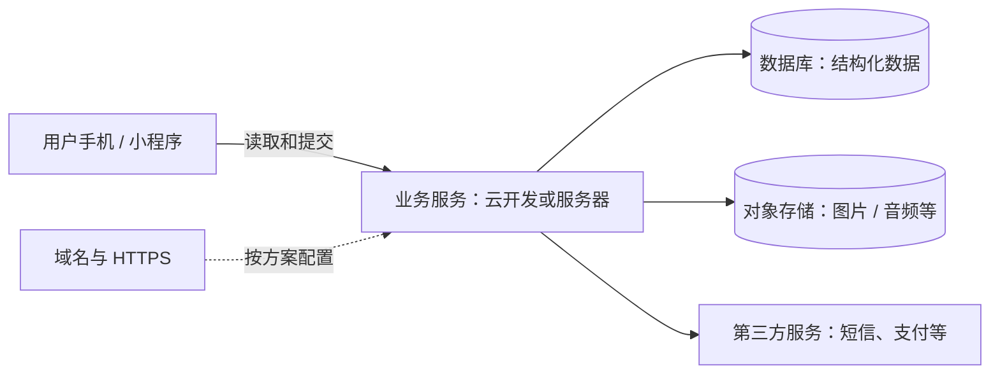

# 小程序与 App 上架指南：从零到正式发布

> 写给第一次做产品的朋友：代码完成只是起点，账号、备案、隐私、测试、审核和发布都要过关。本文以**中国大陆微信小程序、iOS App Store 和国内安卓应用商店**为主，附海外 Google Play 提示。不同产品、主体和地区的要求不同，请以提交时的官方后台和主管部门要求为准。
>
> 内容核对日期：2026 年 11 月 11 日。本文是实践入门，不替代针对具体业务的法律或资质判断。

## 一、先看全景：上架到底在做什么？



**一句人话：**备案是向有关部门登记或履行相应手续；平台审核是微信、苹果或应用商店检查产品；发布是让用户真正能找到并使用。三者不能互相代替。不同环节可并行准备，但不要等代码写完才确认类目和资质。

### 先回答这 7 个问题

1. **做什么？** 写一句话描述用户可以完成的操作，再列出登录、内容发布、支付、定位、健康信息等实际功能。
2. **谁负责？** 个人、个体工商户还是公司？产品主办者、开发者账号、备案主体、商户主体是否一致？不一致时先查平台是否允许以及需要什么授权。
3. **给谁用？** 只在中国大陆，还是还要在其他国家和地区发布？
4. **发到哪里？** 微信小程序、苹果 App Store、华为/小米/OPPO/vivo 等安卓商店，或 Google Play？每个平台有自己的后台和规则。
5. **是否联网？** 需要保存账号、同步数据、发送消息、音视频或在线支付吗？哪些内容只保存在手机？
6. **涉及哪些数据和权限？** 手机号、位置、相册、麦克风、健康数据、设备信息、第三方 SDK 等分别做什么？
7. **业务是否特殊？** 游戏、医疗健康、金融、新闻、出版、宗教、教育、用户发布内容、交易等可能有额外限制或资质。

> **先做判断，再付费。** 不要因为一篇教程说“必须买服务器”“必须办营业执照”就直接购买或办理。先确认你的业务、平台、接入方案和所在地规则。

## 二、准备一个资料文件夹

| 类别 | 建议准备 | 注意 |
|---|---|---|
| 主体 | 身份证明，或营业执照及负责人/经办人材料 | 平台要求因主体类型不同而不同；敏感材料只提交官方渠道 |
| 联系方式 | 能长期接收消息的邮箱、电话 | 备案核验和审核反馈可能需要联系负责人 |
| 产品信息 | 名称、一句话介绍、功能清单、类目、目标地区 | 名称、主体、包名和备案资料尽量保持一致 |
| 视觉素材 | 图标、真实功能截图、商店展示图 | 按各后台规定尺寸准备；展示真实功能，避免虚假宣传 |
| 审核资料 | 测试账号、登录方式、操作步骤、特殊功能说明 | 账号需能让审核人员实际进入；不要提供私人主账号 |
| 隐私材料 | 隐私政策、数据清单、权限用途、SDK 清单、删除方式 | 内容必须与产品和 SDK 实际行为一致 |
| 专项材料 | 许可证、授权书、商标或版权证明等 | 只有相关业务要求时准备；向官方核实适用条件 |
| 技术资料 | App ID、包名、域名、服务商、签名及证书管理记录 | 密钥和证书私钥安全保存，**不要放公开仓库** |

**文件整理范例：**`01主体资料 / 02产品介绍 / 03备案 / 04审核截图 / 05隐私与协议 / 06审核沟通 / 07版本记录`。身份证、营业执照、密钥、测试账号和联系方式不要放进公开链接或公开 GitHub 仓库。

## 三、备案：先分清几个容易混淆的词



- **网站备案**与**App 备案**面向不同服务对象，已有网站备案不等于 App 已备案；已有主体信息是否能复用，要看实际备案系统。微信小程序属于工信部通知所覆盖的移动互联网应用程序形态之一。
- 对在中国大陆提供互联网信息服务的应用，先核实是否适用 App 备案或许可，再按实际接入方式通过网络接入服务提供者或应用分发平台办理。工信部说明材料齐全准确时，省级通信管理局在收到材料后 **20 个工作日内**予以备案；这不是从你开始填写资料起算的保证完成时间。[工信部解读](https://www.miit.gov.cn/zwgk/zcjd/art/2023/art_39b4f1acc36745b98478e0ec3e07128d.html)
- **备案不等于经营许可，也不等于行业资质。** 是否涉及增值电信业务许可、游戏、医疗、出版等，取决于实际业务；拿不准时提交功能说明给平台和主管部门咨询。
- **网站和 App 的号码不是随便互填。** 中国大陆 App Store 的有关编号和简体中文元数据须与工信部备案信息一致；苹果对部分类型产品还有额外材料要求。[Apple：App 信息](https://developer.apple.com/cn/help/app-store-connect/reference/app-information/app-information/)
- 工信部要求在 App 显著位置标明备案编号，并按要求链接备案系统；具体展示方式按适用要求和平台指引落实。[工信部通知](https://wap.miit.gov.cn/jgsj/xgj/wjfb/art/2023/art_dd783a581c9644a4aee10afa582811db.html)

### 办理时通常怎么做？

① 找到实际接入服务商或分发平台的备案入口 → ② 选择主体类型与备案类型 → ③ 按提示填写主体、负责人、应用、网络资源和必要材料 → ④ 实名核验、接听核验电话并处理短信验证 → ⑤ 等初审与管局审核 → ⑥ 保存结果，在平台后台填写并按要求展示 → ⑦ 主体或应用信息变化后及时核对是否需要变更。

**常见卡点：**负责人手机接不到核验、名称不一致、业务描述太模糊、材料照片不清、域名/网络资源信息填错、特殊业务缺材料。不要编造或借用不属于自己的主体及资质。

## 四、云空间、服务器和域名：到底要买什么？



| 名词 | 用大白话解释 | 什么时候考虑 |
|---|---|---|
| 本地存储 | 数据存在用户设备上 | 简单离线工具；换机、卸载后数据可能丢失，先告知用户 |
| 云开发 | 由平台提供数据库、云函数、存储等组合能力 | 想少维护服务器时；注意地域、权限、计费和平台限制 |
| 云服务器 | 一台你可以部署服务程序的远程电脑 | 要自定义后台、接口或运行环境时；需要维护安全与更新 |
| 对象存储 | 保存图片、音频、视频等文件的空间 | 用户上传文件或需要远程分发素材时；流量可能单独计费 |
| 数据库 | 保存账号、记录和业务数据 | 需要账号、同步或多人共享时；做好权限、备份和删除 |
| 域名与 HTTPS | 域名是访问名称，HTTPS 加密传输 | 根据平台网络请求规则和服务部署方案配置 |
| CDN | 把内容分发到不同节点 | 大量用户访问图片、视频或下载资源时再评估 |

**选择顺序：**先画数据流，确定哪些必须联网、是否需要跨设备同步；再比较云开发和自建后台，最后选择套餐。免费额度不等于永远免费：检查存储、请求次数、下载流量、短信、数据库、备份、超额和续费规则，设置预算提醒。重要数据至少验证一次恢复备份的过程。小程序的网络域名、HTTPS、权限和备案具体要求以微信及服务商最新规则为准。

**举例：**一个只在本机记录清单的工具，和一个支持登录、云同步、用户上传音频的社区，基础设施、隐私与资质需求会完全不同。不能根据名字判断，必须看真实功能。

## 五、微信小程序：从注册到用户可以打开

### 1）注册和设置

1. 进入[微信公众平台](https://mp.weixin.qq.com/)，选择注册小程序，使用可长期接收邮件的邮箱，按页面选择主体类型并完成身份核验。
2. 在后台补全名称、头像、介绍、服务类目、管理员和开发成员。类目必须符合真实功能；有的类目只接受特定主体或需要证明材料。
3. 查看并保存自己的 AppID；它是项目标识，不等于开发密钥。AppSecret、上传密钥及管理员权限不得公开。
4. 在后台查看小程序备案入口和当前要求，结合接入商办理所需备案及资质。涉及云开发时，先确认所选方案的实际备案路径。

### 2）开发与测试

1. 安装微信开发者工具，用有权限的微信账号登录，导入项目并填写正确 AppID。
2. 按需要配置网络请求合法域名、云环境、隐私保护指引、权限用途、服务器或第三方服务；以后台实际显示为准。
3. 在模拟器检查页面和基本流程，再通过开发版或体验版让受邀人员在真实手机微信中测试。**开发版、体验版不是正式上线。**
4. 检查首次进入、授权拒绝、网络异常、登录退出、数据保存、不同屏幕和系统版本；有音频、支付等功能还需单独实测。

### 3）上传、审核、发布

1. 开发者工具上传代码版本并填写版本号及说明；登录小程序后台，在版本管理中找到上传的版本。
2. 按提示补全服务类目、功能介绍、隐私和审核资料，需要登录的提供可用测试路径及账号；提交审核。
3. 查看后台审核状态。被驳回时逐条修复或说明，必要时上传新版本并重新提交。
4. 审核通过后，按后台状态确认是否需要**手动发布**，不要把“审核通过”误认为所有用户已经能看到。
5. 用非开发者账号打开正式版，核对名称、页面、功能、网络、备案展示及客服路径。记录正式版本号和发布时间。

## 六、iOS：App Store 上架完整路径

### 1）注册开发者账号

- 准备 Apple 账户并启用平台要求的安全验证，进入 [Apple Developer Program](https://developer.apple.com/cn/programs/enroll/) 根据真实身份选择个人或组织。
- 个人与组织在对外显示名称、资格和材料方面不同。组织通常需要具备法人资格、D‑U‑N‑S 编号、可联系的工作邮箱和网站等；请看实际注册要求。Apple 当前列示年费 99 美元或当地货币，地区价格和缴费方式以注册页面为准。[注册与会员资格](https://developer.apple.com/cn/help/account/membership/program-enrollment/)
- 付款前确认主体和店铺显示名称。**个体工商户不应自动等同于 Apple 组织账号资格**，以 Apple 核验结果为准。

### 2）建立 App 并上传构建版本

1. 在 Apple Developer 配置 App ID、必要能力、证书和描述文件；谨慎保管签名私钥。使用 Xcode 自动签名也需要确认团队和 Bundle ID 正确。
2. 在 [App Store Connect](https://appstoreconnect.apple.com/) 创建 App 记录，选择平台、名称、主要语言、Bundle ID 和内部 SKU。Bundle ID 和打包项目必须对应。
3. 开发完成后在真机测试；使用 Xcode 的 Archive/Distribute 或 Apple 支持的上传工具上传构建版本，等待处理完成。必要时用 TestFlight 邀请测试，留意内部与外部测试的不同要求。
4. 填写商店信息：名称、描述、关键词、类别、年龄分级、支持网址、隐私政策网址、截图、版权等；是否需要其他材料以后台和功能为准。
5. 如计划在中国大陆上架，核实适用的备案编号和材料，确保名称、主体及元数据与备案信息一致；游戏、新闻、出版等可能有额外要求。
6. 在“App 隐私”如实说明 App 及第三方 SDK 的数据收集情况；隐私政策需要在商店元数据和 App 内易于访问。允许用户创建账号的 App，按适用规则提供账号删除功能。[Apple 审核指南](https://developer.apple.com/app-store/review/guidelines/)

### 3）提交、沟通、发布

1. 在版本页面选择已处理好的构建版本，填好审核联系人、测试账号、操作说明和特殊说明。
2. 点击 **Add for Review（添加以供审核）**后，还要进入提交页面点击 **Submit for Review（提交以供审核）**。看到等待审核或审核中，才表示已进入后续流程。[Apple 提交流程](https://developer.apple.com/help/app-store-connect/manage-submissions-to-app-review/submit-an-app/)
3. 在 App Store Connect 查看状态和消息，邮箱通知是提醒，具体操作以后台为准。若被拒绝，先读条款和截图，修复后回复或重新上传新构建版本。
4. 选择手动或自动发布方式。审核通过后检查实际销售地区和状态；产品出现在商店可能需要时间。[Apple 分发说明](https://developer.apple.com/app-store/get-started/)
5. 在真实设备与目标地区的商店搜索、安装，检查权限、登录、订阅、价格和支持链接。

> **账户权限提示：**App Store Connect 的团队成员权限、App 的客户销售地区、审核测试账号是三回事。给协作者的权限按实际工作最小化，不要为了“上架”随意授予所有权限。

## 七、安卓：国内应用商店与海外 Google Play

安卓不是只有一个上架入口。同一个 APK/AAB 无法自动在所有商店发布；各厂商有各自的开发者认证、资料、审核、格式、隐私和分发规则。

### 国内应用商店通用步骤

1. 选目标商店，注册开发者账号，按要求认证个人或组织主体；查看是否接受你的主体及类目。
2. 确认应用包名、应用名称、签名证书、版本号和目标系统版本；发布后签名密钥应长期保管，丢失可能影响更新。
3. 根据商店要求准备 APK 或其他指定格式，完善图标、截图、介绍、隐私政策、备案编号、分类和必要资质。
4. 涉及登录、付费或特殊操作的，提供审核专用测试账号和可复现的使用步骤。
5. 提交审核，留意后台与邮件；针对隐私检测、权限、闪退、资料不一致逐项修复。审核通过后确认是否已正式上架，在对应品牌真机上下载安装并验收。

例如，[华为发布应用指引](https://developer.huawei.com/consumer/cn/doc/app/agc-help-releaseapkrpk-0000001106463276/)列出了包名、备案、隐私检测和审核账号等要求。其他商店请分别查阅其官方后台，不能直接套用华为规则。原生 HarmonyOS 应用与 Android 应用的包格式、开发工具和审核入口也可能不同，应分别确认。

### Google Play 海外发布补充

通过 [Google Play Console](https://play.google.com/console/) 注册并完成开发者身份验证，创建应用、准备 AAB、商店信息、内容分级、数据安全和目标地区，再按平台流程测试并申请发布。某些新个人开发者账号须先完成封闭测试：官方说明至少 12 名测试者连续参与 14 天后才能申请正式发布权限，具体适用范围和最新要求以后台为准。[Google 官方测试要求](https://support.google.com/googleplay/android-developer/answer/14151465)

## 八、隐私、支付、内容和安全：功能越多，检查越细

- **隐私政策不是复制粘贴。** 列清实际收集什么、为何收集、保存多久、第三方 SDK 做什么、如何撤回同意和申请删除，检查所有声明与真实行为一致。
- **权限按需要申请。** 在功能需要时解释原因；拒绝后提供合理反馈。测试相机、相册、定位、麦克风、通知等被拒绝时的体验。
- **账号和删除。** 有登录就测试退出、密码找回、账号删除或注销流程；核实各平台和适用法律的具体要求。
- **付费方式。** 实物交易、线下服务、数字内容或订阅适用规则可能不同；先查看对应平台及地区规则，测试购买、恢复购买、取消续订及价格展示，不要假设一种支付方式适用全部场景。
- **用户生成内容。** 评论、私信、图片上传等可能需要举报、屏蔽、内容管理及其他机制；具体依据平台及业务要求设计。
- **第三方素材和 SDK。** 图标、字体、音乐、图片及代码须确认可用于相应场景；清理不必要 SDK 并核查隐私行为。
- **不要泄密。** 密钥、令牌、证书私钥、数据库、用户数据、审核账号和真实身份材料不要放到公开仓库、截图或教程里。

## 九、邮件与审核沟通：收到消息怎么办？

先确认发件域名和消息是否能在对应官方后台找到；不要通过陌生链接提交密码或验证码。留意垃圾邮件、短信和后台通知。需要沟通时，优先在相关工单或审核页面回复；Apple 对当前审核的沟通尤其建议使用 App Store Connect 对应入口。[Apple 审核沟通](https://developer.apple.com/cn/help/app-review/after-submitting-for-review/contact-app-review)

### 模板 A：咨询备案或资质

```text
主题：关于【应用类型 / 名称】备案或资质要求的咨询

您好，我们计划以【个人 / 个体工商户 / 企业】主体，面向【地区】提供【一句话功能】。
主要功能包括：【功能列表】；是否需要账号：【是 / 否】；
是否涉及用户发布内容或交易：【实际情况】；网络接入方案：【实际方案】。
请问该场景适用的备案入口、主体要求及需要准备的资料是什么？
如需补充信息，请告知。谢谢。
```

### 模板 B：回复审核问题

```text
您好，感谢反馈。
针对【审核意见或条款编号】：
1. 我们理解的问题是：【具体问题】。
2. 已采取的修改：【修改内容及所在页面】。
3. 复现 / 验证路径：【从打开 App 到看到结果的步骤】。
4. 新提交版本或构建号：【版本号】，测试方式：【安全提供方式】。
如有理解不准确之处，请指出需要进一步调整的部分。谢谢。
```

**审核账号要安全交付：**只在平台指定的审核资料区域或安全工单中提供；不要公开发在 GitHub、群聊或社交媒体。测试数据使用虚构内容，限制权限和有效期，并确保审核期间可用。

## 十、提交前最后检查清单

- [ ] 主体、发行地区、目标平台、功能及类目已确认；特殊业务的资质已核实。
- [ ] 应用备案、网站备案和行业许可分别判断；需要办理的已完成并按要求展示。
- [ ] 名称、包名、主体、备案及商店资料一致，所有链接可从外部打开。
- [ ] 隐私政策、数据收集说明、权限用途和 SDK 行为一致，用户可找到支持与删除路径。
- [ ] 真机测试核心功能、异常网络、授权拒绝、登录、退出、付费和不同设备。
- [ ] 截图来自真实功能；图标、音乐、字体、图片及其他素材有相应使用权。
- [ ] 审核账号可用，操作步骤清晰，涉及特定地区或硬件的条件已说明。
- [ ] 正确选择版本和构建包；签名、证书、后台密钥和备份已安全保存。
- [ ] 云资源、流量、短信、会员费和续费规则已核对并设置预算提醒。
- [ ] 审核通过后还要确认发布状态，用普通用户账号安装或打开正式版。

## 十一、发布后也要做的事

记录正式版本、审核说明和使用的第三方组件；监控崩溃、错误、费用和用户反馈；及时更新过期证书、依赖和政策。主体、名称、域名或服务发生变化时，核对是否需要更新备案和各商店信息。每次更新重新走对应平台的审核及发布流程，并保留回退和数据恢复方案。

## 官方入口与进一步阅读

- [工业和信息化部：App 备案政策解读](https://www.miit.gov.cn/zwgk/zcjd/art/2023/art_39b4f1acc36745b98478e0ec3e07128d.html) · [备案查询](https://beian.miit.gov.cn/)
- [微信公众平台](https://mp.weixin.qq.com/) · [微信开放文档](https://developers.weixin.qq.com/miniprogram/dev/framework/)
- [Apple Developer 注册](https://developer.apple.com/cn/programs/enroll/) · [App Store 审核指南](https://developer.apple.com/app-store/review/guidelines/) · [App Store Connect 帮助](https://developer.apple.com/cn/help/app-store-connect/)
- [华为应用市场发布应用指引](https://developer.huawei.com/consumer/cn/doc/app/agc-help-releaseapkrpk-0000001106463276/) · [Google Play 封闭测试要求](https://support.google.com/googleplay/android-developer/answer/14151465)
- [网站备案与 App 备案区别：华为云](https://support.huaweicloud.com/icp_faq/icp_05_0253.html)

> 如平台页面、价格和政策发生变化，请以最新官方公告、当地主管部门及你的后台实际要求为准。
